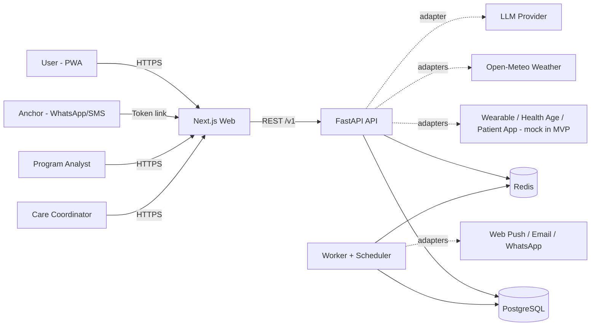
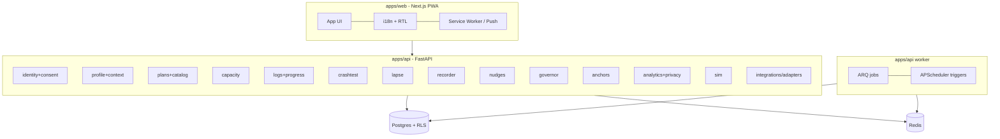
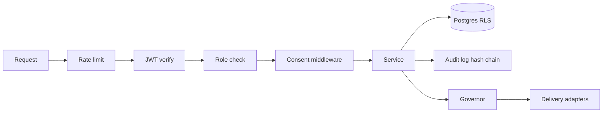
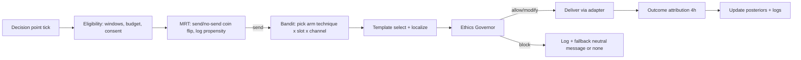
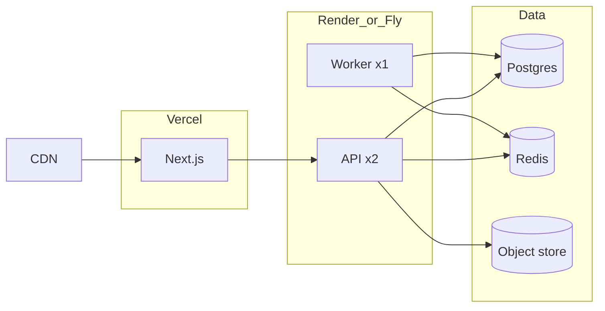

# Rebound — Architecture

Version 1.0

## 1. Architectural Principles
1. **Lapse-first:** every component assumes disruption; state machines include `AT_RISK`, `LAPSED`, `RESTARTING`.
2. **Ethics in the path:** nothing reaches a user without passing the Governor.
3. **Privacy by construction:** consent middleware + Postgres RLS + aggregate-only analytics role.
4. **Explainable by default:** every adaptive decision stores inputs, rule/arm, and a user-readable reason.
5. **Swap-friendly:** external systems behind adapters; MVP ships mocks.
6. **Modular monolith first:** clear module boundaries now, service split later if needed.

## 2. Context Diagram

## 3. Container & Module View

### Module responsibilities and dependencies
| Module | Responsibility | Depends on |
|--------|----------------|-----------|
| identity+consent | auth, roles, consent ledger, audit | — |
| profile+context | user profile, culture/work/accessibility, context events | identity |
| plans+catalog | goals, plans, actions, levels, action catalog | profile |
| capacity | daily capacity score + explanation | profile, integrations |
| logs+progress | daily logs, consistency score, comeback events | plans |
| crashtest | scenario simulation + patch search | plans, profile |
| lapse | features, hazard, state machine, restart | logs, capacity |
| recorder | Flight Recorder, barrier classification, recovery rules | lapse, context |
| nudges | decision points, MRT, bandit, outcome attribution | plans, lapse, governor |
| governor | policy evaluation and audit | profile, consent |
| anchors | Rescue Link | identity, governor |
| analytics+privacy | aggregates, DP, equity, program endpoints | all (read via views) |
| sim | agent-based study | crashtest, nudges (policy interfaces) |
| integrations | adapters (mock/live) | — |

Rule: modules communicate via service interfaces and domain events; no cross-module table access except through read models.

## 4. Key Domain Events
`user.consented`, `plan.committed`, `checkin.recorded`, `log.recorded`, `capacity.updated`, `risk.raised`, `lapse.detected`, `restart.completed`, `recorder.completed`, `rule.accepted`, `nudge.candidate`, `nudge.decided`, `nudge.delivered`, `nudge.outcome`, `anchor.requested`, `consent.changed`, `export.requested`, `account.deleted`.
Delivered via outbox table → worker consumers (idempotent).

## 5. Data Architecture
- **OLTP:** Postgres with RLS (`app.user_id` GUC). Roles: `app_rw` (API), `worker_rw`, `analytics_ro` (aggregate views only), `migrator`.
- **Read models:** `v_today_plan`, `v_consistency_28d`, `v_user_lapse_state`.
- **Aggregates:** `agg_persistence`, `agg_rhl`, `agg_outcomes`, `agg_retention`, `agg_equity` — written by `aggregate_release` job with k-suppression and Laplace noise.
- **Blob storage:** exports (zip) and simulation artifacts in object storage (S3-compatible) with expiring URLs.

## 6. Security Architecture

- Trust boundaries: browser ↔ API (TLS, CSP), API ↔ DB (RLS), API ↔ external adapters (allow-listed egress), program role ↔ aggregates (separate DB role).
- Secrets: platform secret manager; app-level encryption key in KMS.

## 7. Nudge Pipeline (critical path)

## 8. Deployment Architecture

- Local: `docker-compose` with web, api, worker, postgres, redis, mailpit.
- Zero-downtime: rolling deploy; DB migrations use expand → deploy → contract.

## 9. Scalability & Capacity Planning
- Stateless API behind LB; autoscale on CPU/latency.
- Worker scale-out by queue depth; nudge ticks partitioned by `hash(user_id) % N`.
- DB: indexes on `(user_id, date)`; partition `signals` and `nudges` monthly if > 50M rows; PgBouncer for connection pooling.
- Simulation: CPU-bound; cap concurrent crash-tests per user; cache results keyed by `(plan_hash, profile_hash, scenario_version, seed)`.

## 10. Reliability Patterns
- Outbox + idempotent consumers; retries with exponential backoff and jitter; dead-letter queue.
- Circuit breaker around LLM and weather adapters; fallback to templates/cached weather.
- Health endpoints: `/healthz` (liveness), `/readyz` (DB, Redis, migrations).
- Graceful degradation matrix: LLM down → templates; weather down → last known; Redis down → read-only mode with queued writes disabled.

## 11. Observability
- Traces: OpenTelemetry (API → worker) with `user_hash` (not raw id).
- Metrics: request latency, job lag, nudge send rate, Governor block rate by rule, crash-test duration, hazard calibration drift, opt-out rate.
- Logs: structured JSON, PII scrubbing filter.
- Dashboards: Ops, Governor, Learning (bandit posteriors summary), Equity.

## 12. Architecture Decision Records (ADRs)
| ID | Decision | Status |
|----|----------|--------|
| ADR-001 | Modular monolith over microservices | Accepted |
| ADR-002 | Postgres RLS + consent middleware for privacy | Accepted |
| ADR-003 | Governor is a mandatory pipeline stage, pure functions, versioned policies | Accepted |
| ADR-004 | Micro-randomized nudges with logged propensities | Accepted |
| ADR-005 | Aggregates via separate DB role + DP at release | Accepted |
| ADR-006 | LLM optional; schema-constrained; template fallback | Accepted |
| ADR-007 | No streak primitive in data model or API | Accepted |
| ADR-008 | Adapters for all external health systems; mocks in MVP | Accepted |
