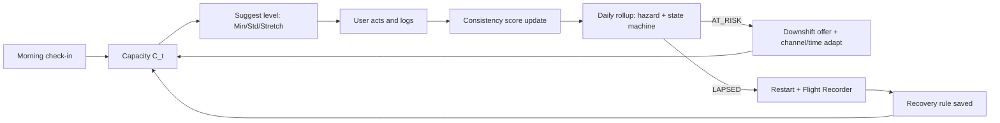
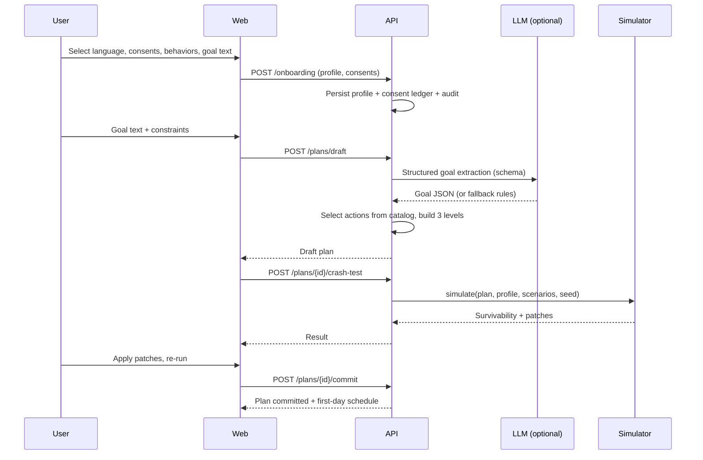
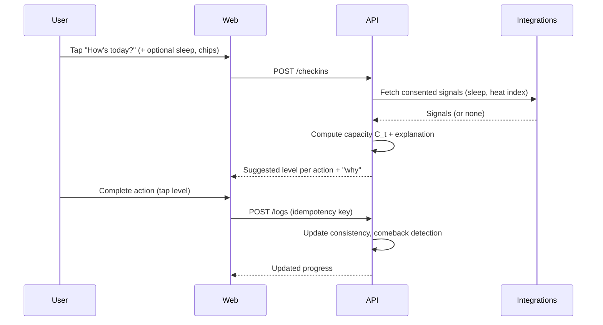
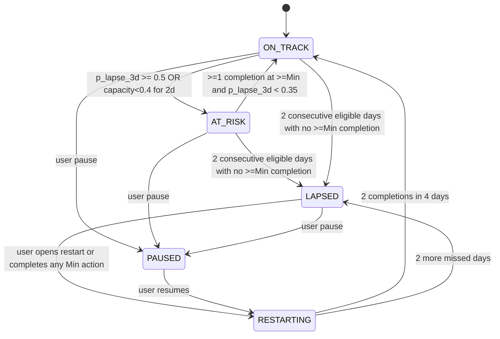
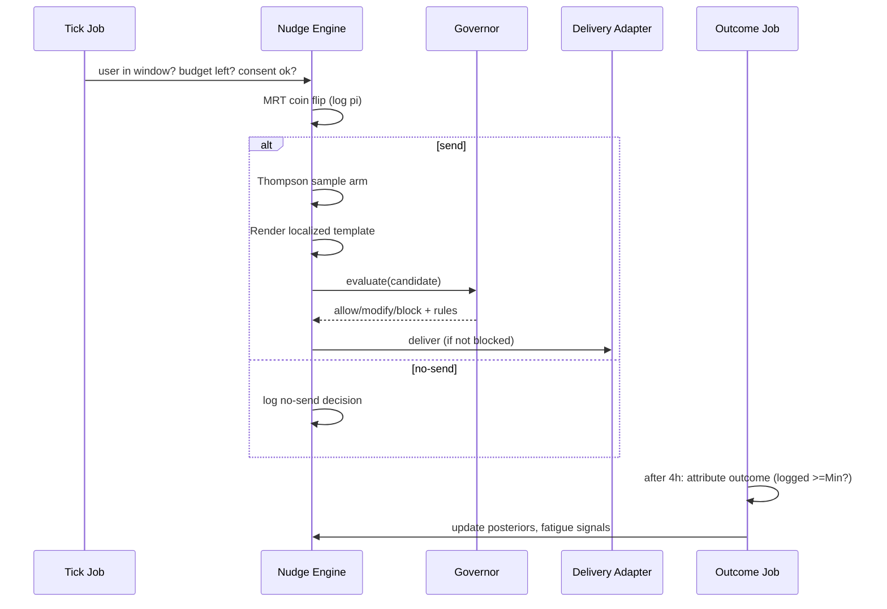
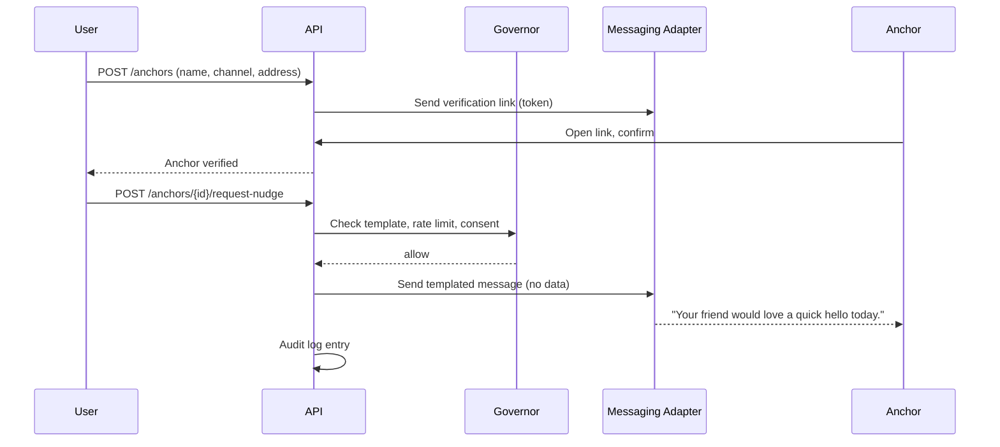
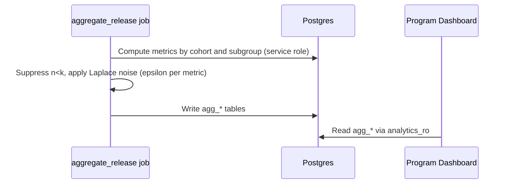

# Rebound — System Design

Version 1.0. Runtime behavior, flows, state machines, and scaling.

## 1. Core Runtime Loop


## 2. Sequence: Onboarding → Crash-Test → Commit


## 3. Sequence: Daily Check-in and Level Suggestion


## 4. Lapse State Machine

- **Eligible day:** not a grace day, not paused, within an active plan window.
- **Comeback event:** transition `RESTARTING → ON_TRACK`; stores days-to-return for RHL.
- No transition ever modifies historical consistency data.

## 5. Sequence: Lapse → Flight Recorder → Recovery Rule
```mermaid
sequenceDiagram
  participant J as Daily Rollup Job
  participant A as API
  participant U as User
  participant W as Web
  participant C as Barrier Classifier
  J->>J: Compute features, hazard, state
  J->>A: event lapse.detected
  A->>A: Governor-checked restart nudge
  A-->>U: Push: gentle restart (Minimum Viable Day)
  U->>W: Opens Flight Recorder
  W->>A: GET /recorder/{lapse_id}
  A-->>W: 7-day timeline + context chips
  U->>W: Taps "What got in the way?" (chip/free text/voice)
  W->>A: POST /recorder/{lapse_id}/answer
  A->>C: Classify barrier (rules, optional LLM)
  C-->>A: barrier + confidence
  A->>A: Generate recovery-rule proposal (template + optional LLM paraphrase)
  A-->>W: Proposed rule
  U->>W: Accept / edit
  W->>A: POST /rules
  A->>A: Persist; update Lapse Signature; adjust plan windows
```

## 6. Sequence: Nudge Decision Point


## 7. Sequence: Rescue Link


## 8. Sequence: Aggregate Release (privacy)


## 9. Crash-Test Execution Design
1. Load scenario YAML (versioned) and plan; derive per-action schedule.
2. For each scenario: sample N=300 runs; per day compute capacity multiplier, window blocks, cue availability.
3. Per run: simulate completion probabilities with habit-strength dynamics (ml-spec §3).
4. Aggregate: survival rate per scenario, failure reasons (dominant blocker).
5. Patch search: generate candidate edits, re-simulate affected scenarios only, pick best marginal gain per effort.
6. Cache by hash; return partial progress via SSE if > 1.5 s.

## 10. Notification Channel Adaptation
Channel ladder per user: push → email → WhatsApp/SMS → coordinator-assisted (only if opted in). Rule: switch up the ladder after 3 consecutive ignored sends (no open/dismiss within 24 h) and user has authorized the next channel; switch back after 2 engagements. Channel changes are logged and visible in settings.

## 11. Time and Localization Handling
- Store UTC; evaluate windows in user's IANA timezone.
- Ramadan: computed from Hijri calendar library plus user toggle; shifts windows (iftar/suhoor); disables daytime hydration/eating actions as applicable.
- Daily rollup at user-local 02:00; DST-safe scheduling via per-user next-run times.

## 12. Concurrency and Idempotency
- All POSTs from client carry `Idempotency-Key`; server stores key → response for 24 h.
- Job handlers keyed by `(job_type, user_id, date)`; duplicate runs are no-ops.
- Optimistic concurrency (`version` column) on plans and rules to avoid lost updates.

## 13. Failure Modes
| Failure | Behavior |
|---------|----------|
| LLM timeout | Template fallback; mark `llm_fallback=true` |
| Weather API down | Use last cached heat index ≤ 6 h old, else skip heat input |
| Wearable sync gap | Capacity uses self-report only; explanation notes missing input |
| Push delivery failure | Retry; after 3 failures switch channel if authorized |
| Governor error | Fail closed (no nudge sent); alert |
| Simulation timeout | Return partial results flagged `partial=true` |

## 14. Scaling Notes
- Hot paths: check-in (write), today view (read), nudge tick (batch).
- Today view served from `v_today_plan` with Redis cache (30 s TTL, busted on writes).
- Nudge tick: batch users by shard; cap per-tick processing time; backpressure via queue depth alerts.
- Analytics read models refreshed incrementally.
